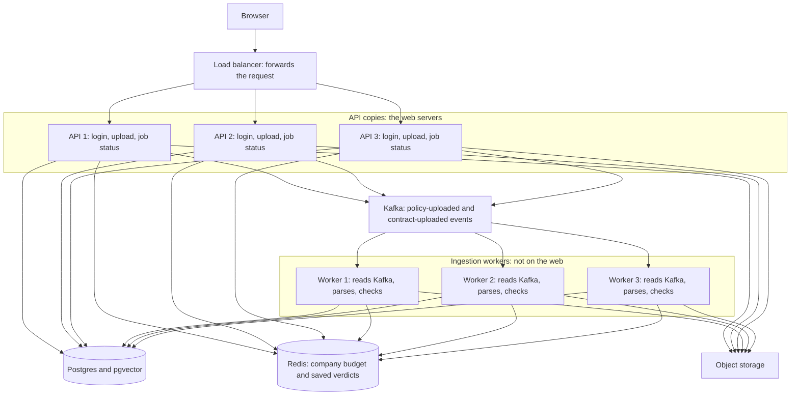
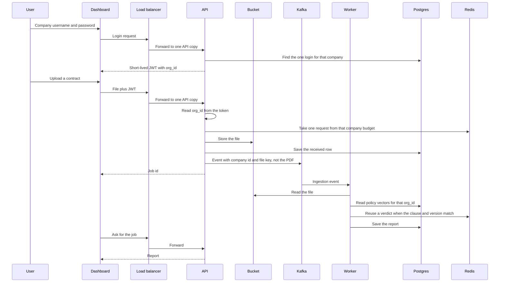
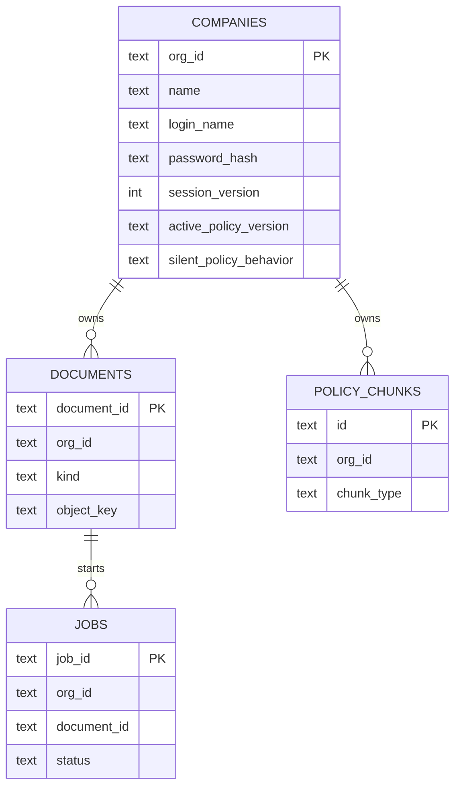

# Contract Checker — production plan

This is the living plan. When the plan changes, edit this file. Do not start a second roadmap.

`architecture_diagrams.md` is an old note. It describes a design that is not in this repository.

Last updated: 2 November 2026.

The client and the bill come first. A part is built when a client can see it, or when the current part cannot carry the next client. Kafka, a paid gateway product, and a second cloud wait until that reason is true.

Two limits stay separate. The company HTTP budget is one Redis counter keyed by `org_id`. It does not know how many clauses are in a file. The checker counts model requests and tokens, because only the checker sees the clauses. The local nginx limit is only for the single proxy on this machine.

## Where the code is today

One Python application checks a vendor contract against a company policy.

- Streamlit is the developer screen. The organization id there is still typed.
- The client screen is `apps/dashboard/index.html`, served by the API at `/`. It stores the login token in the browser and calls only this API.
- `POST /v1/register` and `POST /v1/login` store one username and one slow password hash on the company row. A newer login increments `session_version`, and the previous token stops working.
- `deploy/nginx/default.conf.template` is the local proxy on port 8080. It looks up the Docker name `api`, so every API copy is included. `API_REPLICAS` and `WORKER_REPLICAS` set the counts. The default is 2. Its request counter is in nginx memory. The production company budget is a later Redis key per `org_id`.
- Compose runs that many API copies and workers from the same image. Port 8080 is the door. A copy does not keep a session file. The workers share the job table, so a third worker takes a different row.
- In Docker, policy sections and the company row live in Postgres with pgvector. The image is `contract-checker-app`. That image has to be rebuilt before the container contains the API and the login.
- Cached verdicts in Docker go to Redis. Exact text is one key. A near match still uses the number and negation rules in `core/cache.py`. A policy upload deletes that company's keys. The host `.env` still says `CACHE_BACKEND=sqlite`, so `streamlit run` on this machine does not need Redis. The company HTTP budget is not in Redis yet.
- A local `streamlit run` still follows `.env`, which points the policy store at SQLite.
- Original PDFs go to `data/objects` on this machine, or `/data/objects` inside Docker. The database stores the key in `stored_documents`.
- A policy upload and a contract upload write a `jobs` row and return a job id. `scripts/worker.py` claims that row, reads the PDF from object storage, and writes the report. The dashboard polls `GET /v1/jobs/{job_id}`. A pasted clause still returns in the same request. Kafka is not running.
- A new `docker compose up` runs `scripts/prepare_runtime.py` before Streamlit, the API, and the worker. That creates the Postgres tables, the job table, and the file folder on that machine's volumes. The image itself stays empty of customer data.

Git `main` on the remote is commit `d779284`. The working tree has local edits and is not committed.

## Production shape we locked

One HTTP load balancer. It only forwards web requests. It does not log anyone in and it does not check a contract.

An API copy is the web server. The browser talks only to these. An API copy checks the company login, counts that company in Redis, stores the uploaded file, writes a job row, and later reads that row when the browser asks for the report. It does not run the long contract check.

A worker copy is not on the web. Nobody's browser connects to it. It picks up a job row from Postgres and runs the LangGraph check. Three API copies and three worker copies are drawn so the picture shows scale. The first deploy can run one of each. Postgres, Redis, and the file bucket are shared. The copies are private. Only the load balancer is public.

The job row in Postgres is the status the browser can ask for. Kafka carries the ingestion event after the file is stored: company id, document id, and the storage key. The PDF itself stays in object storage. Ingestion workers read those events, parse and embed policies, and run the contract check. Many clients each uploading several policies and contracts is the reason for that split. The web request returns as soon as the file and the event are accepted. It does not wait to parse every PDF.

The local nginx container is a stand-in for the one load balancer on this machine. Its memory counter is not the production company budget. Compose starts as many API copies and workers as `API_REPLICAS` and `WORKER_REPLICAS` say. The default is 2. Kafka is not running. A pasted clause still returns in the same request.

```mermaid
flowchart TD
  a["1 User uploads the company policy"]
  b["2 Load balancer picks one API copy"]
  c["3 API checks the company login"]
  d["4 Rate limiter in Redis: one budget for that company"]
  e["5 Object storage keeps the PDF"]
  f["6 API writes a received row in Postgres"]
  g["7 Kafka event: policy uploaded, with company id and file key"]
  h["8 API tells the user the upload was accepted"]
  i["9 Ingestion worker reads the Kafka event"]
  j["10 Worker parses the policy into Postgres sections and vectors"]
  k["11 User uploads a vendor contract"]
  l["12 Load balancer, login check, and the same rate limiter again"]
  m["13 Object storage keeps the contract"]
  n["14 Kafka event: contract uploaded"]
  o["15 API returns a job id"]
  p["16 Worker reads that event and runs LangGraph against the company policy"]
  q["17 Redis returns a saved verdict when the clause matches"]
  r["18 Postgres stores the report"]
  s["19 User asks the API and receives the report"]

  a --> b --> c --> d --> e --> f --> g --> h --> i --> j --> k --> l --> m --> n --> o --> p --> q --> r --> s
```

## How a check will move

The organization id is not typed, and it is not trusted from the request body. It is a claim in the token. For this version, one company has one username and one password. Every employee of that company uses that same login. A new login replaces the previous one, so only one session is active for that company. Google and LinkedIn are a later choice. The product does not depend on them.

## Why this order

Real products that lasted did not start as five services. Stripe, early Shopify, and most contract tools began as one application with a database and a place for files. They split a worker when PDF work made web requests slow. They added Kafka when many independent programs needed the same durable history. LinkedIn, Uber, and Netflix run Kafka because they are at that second point. A contract checker with its first clients is at the first point.

| You asked for | What production teams do first | Why we wait |
| --- | --- | --- |
| Our own register and login | One username and password on the company row | Employees share it for now. Per-person accounts come later, on the same `org_id` |
| Google and LinkedIn | Leave them off until a client asks | Sign-in must work with our laptop off the public internet. Social login needs an HTTPS callback |
| Company row, `org_id` as the key | Extend the tenant row we already have | A second company id would split policy data from login |
| Edge that limits HTTP calls and later balances them | A small reverse proxy in front of the API | It counts requests per minute. It does not count clauses or model tokens. A paid gateway product waits |
| PDF and DOC in a cloud bucket | An S3-compatible bucket. MinIO locally, one cloud later | The upload code speaks the S3 API, so AWS, GCS, or Azure is a config change |
| Kafka for ingestion | An event after the file is stored: company id and file key | The PDF stays in object storage. Kafka is not placed in front of Postgres. The cluster waits until many clients are uploading at once |
| Postgres and pgvector | Already the Docker policy store | Keep it. Do not add a second database for vectors |
| Redis | One Redis for all API and worker copies | The SQLite file cannot be shared. Build it when a second copy of the app exists, or just before that |
| Separate services, scale horizontally | More copies of the API, more copies of the worker | Split only the worker. The check code stays one library |
| AWS, GCP, and Azure | One cloud | Three clouds triple the bill and the ops. The bucket and queue are behind adapters |

## Repositories

Use one GitHub repository.

Put future programs in folders of this repo: `services/api`, `services/worker`, and `apps/dashboard`. The checker library stays where it is. One OpenAPI file is the contract between the dashboard and the API.

A company creates a separate repository when a different team owns a program, when that program’s access must be tighter, or when the build is too slow. None of those is true here. Empty repositories for a gateway, a dashboard, and the checker would drift apart before the first request exists.

Google uses one large repository. Amazon uses many. The reason is ownership and build time, not a rule that every service is a repository.

## Data

`COMPANIES.org_id` is the same id already stored on `tenant_configs` and on every policy chunk. The first login is one username and one password on that company row. There is no separate user table yet.

A password is stored as a slow hash. A JWT carries the `org_id`, a session version, and an expiry. It does not carry the password. Login increments the session version. A token from the previous login no longer matches, so only one session is active. That is the meaning of “one person logged in per company.”

Later, employees get their own rows and a membership to the same `org_id`. Policy chunks do not move. Google and LinkedIn, if a client asks, attach to those future person rows. They are not required for register and login.

LinkedIn’s free self-serve product is “Sign In with LinkedIn using OpenID Connect.” The scopes are `openid`, `profile`, and `email`. LinkedIn says this does not verify identity, and the email can be missing. Google sign-in for our own app does not have a per-user fee. A hosted identity product such as Firebase Identity Platform is a different bill. We do not use it.

## Phases

Each phase has a reason you can say out loud, the tradeoff, and the interview line.

### Phase 0 — The checker. Done

The pipeline, Postgres policy store, and Docker app exist. Streamlit remains the developer console.

### Phase 1 — One HTTP API. Done locally, not committed

`services/api.py` is the HTTP door. It accepts a policy PDF, a contract PDF, or one pasted clause, and it calls the checker that Streamlit already uses. A contract check returns the report in the same request. A job id waits for the queue phase. `org_id` is still a field on the request. Phase 3 stops trusting that field and reads the company from the login token.

Streamlit is unchanged and remains the developer screen.

The Docker Compose file starts this API on `127.0.0.1:8000` from the same `contract-checker-app` image, with a different command. The image has to be rebuilt before that container contains this code.

Checked: `.\venv\Scripts\python.exe -m unittest tests.test_api` — 7 tests, exit 0.

### Phase 2 — The edge. Written locally, container not started

`deploy/nginx/default.conf.template` is the reverse proxy. Compose starts it as `edge` on `http://127.0.0.1:8080` and forwards to every API copy. The public door is 8080.

On this one proxy, nginx allows 60 HTTP requests per minute for each caller, with a burst of 20. That counter is in nginx memory. It is not the production budget. Production counts in Redis, one key per `org_id`, so every API copy sees the same number. `/health` is not counted. A contract check can take several minutes, so the proxy waits up to 300 seconds before giving up.

Model requests per minute and tokens per minute stay inside the checker.

The proxy is another container, not another copy of the checker. A paid gateway product would do this job too, and it would bill us before a second service exists.

Checked: the proxy container was not started. Docker Desktop was not running. The API process was started again on `127.0.0.1:8000`.

Interview line: “The edge limits HTTP requests. The model budget stays beside the model, because only that code knows the clauses.”

### Phase 3 — One company login. Done locally, not committed

`POST /v1/register` and `POST /v1/login` are the company door. The password is a slow hash on the company row, next to the existing `org_id`. The token lasts one hour and carries `org_id` plus `session_version`. Login adds one to that version, so the previous token is rejected. Policy upload, contract check, and the single-clause check read the company from the token.

`JWT_SECRET` must be set. It is not in the image. Add it to `.env` before calling login.

Checked with `tests.test_api`, including a second login that invalidates the first token.

### Phase 4 — Dashboard. Done locally, not committed

`apps/dashboard/index.html` is the client screen. The API serves it at `/`. The page registers, logs in, uploads a policy PDF, uploads a contract PDF, and shows the report. Every call goes to this API. The token stays in the browser. Streamlit remains the developer screen.

Checked: `tests.test_api` requests `/` and finds the register and policy-upload labels.

### Phase 5 — Original files. Done locally, not committed

A policy or contract PDF is written to object storage. The database row `stored_documents` keeps the company id, the file name, and the object key. It does not keep the PDF bytes.

`OBJECT_STORE_BACKEND=local` writes `data/objects`. `OBJECT_STORE_BACKEND=s3` uses the S3 API, so the same call can target MinIO or AWS S3. That path needs `boto3`, `S3_BUCKET`, and the S3 credentials. Local is the default, so this machine does not need a bucket yet.

The check still ran in the API request at the end of this phase. Phase 6 moved that work onto the job table.

Checked: `tests.test_stored_files` saves a PDF, reads the same bytes back from the folder, and finds only the key in the database row.

### Phase 6 — A job, not Kafka yet. Done locally, not committed

`POST /v1/policies` and `POST /v1/checks` store the PDF and insert a `jobs` row. The response is the job id. `scripts/worker.py` claims one queued row, reads the PDF back by its object key, and writes the report on that row. Policy jobs use the kind `policy.uploaded`. Contract jobs use `contract.submitted`. The dashboard polls `GET /v1/jobs/{job_id}`. Compose starts the worker from the same image, with no published port. A pasted clause still returns in the request that sent it.

Checked: `tests.test_jobs` accepts a contract without calling the checker, then the worker writes the report. A second claim does not take the running row. Another company gets 404 for that job.

The first queue is the job table, or a Redis list once Redis exists. The message is a job id, not the file.

Reason: many contracts for one company will outlive an HTTP request. A row is durable, visible, and cheap. The event name (`contract.submitted`) stays the same so a later Kafka consumer can replace the reader.

Tradeoff: a database queue is slower to fan out to many consumer types. We have one consumer, the checker.

Interview line: “I used a queue when the work became asynchronous. I adopt Kafka when a second independent consumer needs the log.”

### Phase 7 — Redis for verdicts. Done locally, not committed

`core/redis_cache.py` is the cache class `CACHE_BACKEND=redis` selects. An exact clause is one Redis key. A near-duplicate is still accepted or rejected in `pick_semantic_verdict`, including the number rule and the negation rule. `invalidate(org_id)` deletes that company's keys when a policy is uploaded. Compose runs `redis:7-alpine` and points the API, the worker, and Streamlit at it. A host run stays on SQLite.

A lost Redis key causes one new model call. Policy text is not stored here. The company HTTP budget is a later Redis key. It is not this cache.

Checked: `tests.test_redis_cache` covers an exact hit, a near-duplicate, a rejected number, a rejected negation, company isolation, and deletion of one company's keys.

Reason: two API or worker copies cannot share the SQLite file.

Tradeoff: Redis can lose data if persistence is off. A lost verdict only causes one new model call. That is acceptable. Policy text is not stored here.

Interview line: “The cache is shared and disposable. The system of record is Postgres.”

### Phase 8 — Scale the two programs. Done locally, not committed

Compose runs `api` and `worker`, each with a replica count. The default is 2. Set `API_REPLICAS` or `WORKER_REPLICAS` and run `docker compose up -d` to add a copy. The edge resolves the name `api`, so the nginx file does not list the copies. Port 8080 is the door. Each response names its copy in `X-Served-By`. The copies share Postgres, Redis, and the file folder. A login token is the session. No copy writes a session file.

Checked: `tests.test_edges` sends five workers at five jobs and five workers at one job. The same claim is checked on Postgres with four workers. The nginx template is one upstream name, not a list of two.

Reason: this is horizontal scale at the lowest cost. You add copies of the busy part only.

Tradeoff: the worker is a second deployable. It is the same repository and the same checker library.

Interview line: “I scaled stateless copies behind the edge I already had. I did not make a service per function.”

### Phase 9 — One cloud

Deploy the API, the worker, managed Postgres, managed Redis, and one bucket to a single cloud account. Secrets stay in the host environment. The image we share is still `contract-checker-app` plus the dashboard image.

Reason: a client can use the product without our laptop.

Tradeoff: managed Postgres and Redis cost money every month, including quiet months. One small region is the cheap start. A second cloud is a later adapter, not a second production.

Interview line: “Multi-cloud is an exit plan, not a launch plan.”

### Phase 10 — Kafka, only if the queue is no longer enough

Move the same events onto Kafka when a second consumer must read them independently, or when the job volume makes a single queue the bottleneck. Topics follow the names already used: policy uploaded, contract submitted, check completed.

Reason: giants use Kafka as a durable log for many subscribers. We do not pay for that cluster while there is one subscriber.

Tradeoff: operating Kafka, or a managed Kafka, is a fixed cost. The win is replay and fan-out.

Interview line: “The producer did not change. The transport did.”

### Phase 11 — Partner keys, only if a second kind of client appears

The edge already limits HTTP requests and can balance API copies. Add a paid gateway product only when an outside partner needs their own key and a quota that is not the company login.

Reason: the brake and the load balancer are already there. A second product is a bill.

Interview line: “The edge already counted HTTP requests. A gateway product is for partner keys, not for the first rate limit.”

### Phase 12 — People, and social login if a client asks

Give each employee a password when a company needs to know who did what. Those people belong to the existing `org_id`. Add Google or LinkedIn only when a client asks. Our register and login keep working if those providers are down.

Reason: the pilot did not need a person table. The expansion does not rename the company.

Tradeoff: shared passwords must be retired when more than one person needs an audit trail. LinkedIn may omit email, and it does not verify identity.

Interview line: “Social login is an extra way in. The company password remains the way that does not depend on Google or LinkedIn.”

### Phase 13 — Reading quality, continuously

Customer-specific obligation examples, evidence quotes, and human review stay inside the worker. This work already started in the checker. It does not wait for Kafka.

Reason: a client pays for a report they can trust. Extra infrastructure does not fix a wrong verdict.

## What we will not do in the next build

- We will not create separate GitHub repositories.
- We will not start Kafka.
- We will not subscribe to three clouds.
- We will not throw away Streamlit until the dashboard can run a check.
- We will not copy old SQLite verdicts into Redis. A miss calls the model once.
- We will not require Google or LinkedIn for login.
- We will not build a per-employee account until a company needs one.
- We will not count clauses at the edge. That limit stays beside the model.

## Next build

Phase 9: one cloud account. The company HTTP budget in Redis is still later. Kafka is not running.
