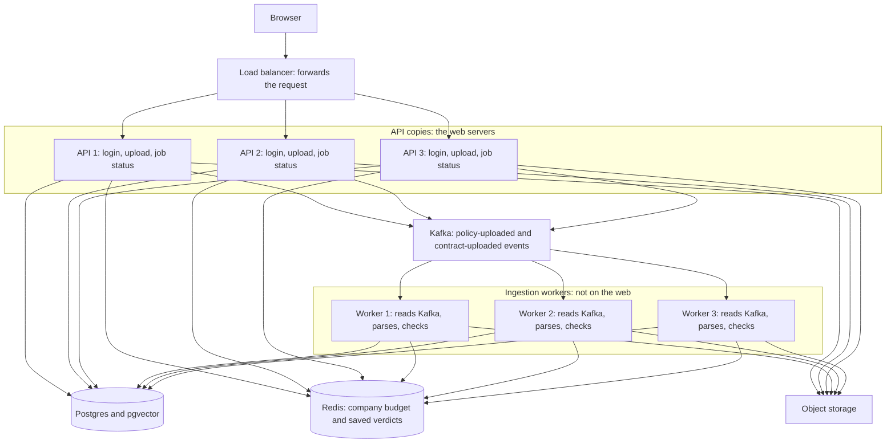
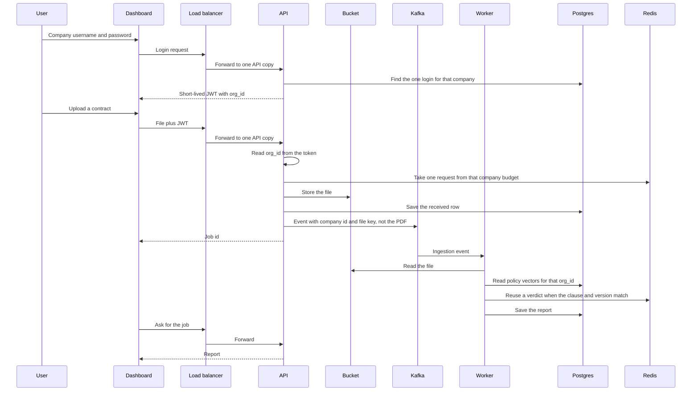
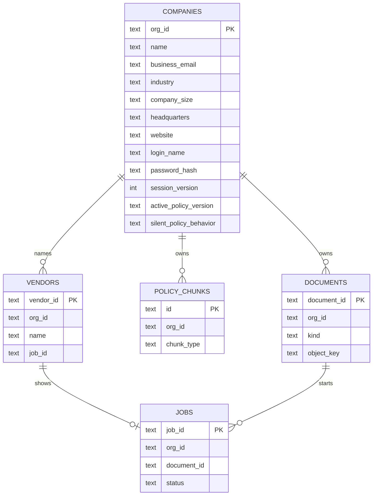

# Contract Checker — production plan

This is the living plan. When the plan changes, edit this file. Do not start a second roadmap.

`architecture_diagrams.md` is an old note. It describes a design that is not in this repository.

Last updated: 6 November 2026.

The client and the bill come first. A part is built when a client can see it, or when the current part cannot carry the next client. Kafka, a paid gateway product, and a second cloud wait until that reason is true.

Two limits stay separate. The company HTTP budget is one Redis counter keyed by `org_id`. It does not know how many clauses are in a file. The checker counts model requests and tokens, because only the checker sees the clauses. The local nginx limit is only for the single proxy on this machine.

## Where the code is today

One Python application checks a vendor contract against a company policy. The flow below is the tracker. A later phase does not erase an earlier one.

1. **Checker.** Done. Streamlit is the developer screen. The company id there is still typed. A laptop run uses SQLite for policies and for the verdict cache.
2. **HTTP API.** Done. `services/api.py` accepts a policy PDF, a contract PDF, or one pasted clause.
3. **Edge.** Done and running. Nginx on port 8080 looks up the Docker name `api`, so every API copy is included. Its 60-request counter is in nginx memory. It is not the company budget.
4. **Company login.** Done. One username and one slow password hash. A newer login invalidates the previous token. Parallel logins each get a new session number in the database.
5. **Dashboard.** The working page is done. The API serves it at `/`. It registers, logs in, uploads a policy, creates a vendor, uploads that vendor's contract, polls the job, and can ask again with a job id. The layout is one column of forms. The visual layout is Phase 15 and has not been started.
6. **Original files.** Done. The database stores the key. Docker API and workers write bucket `contract-checker` on LocalStack. Streamlit still writes a folder. `docker-compose.cloud.yml` is ready for a managed bucket. The paid account is filled in at deploy time. PDF and `.docx` are accepted. The old binary `.doc` format is rejected.
7. **Jobs.** Done. An upload writes a `jobs` row and returns. A worker claims it. A `running` row older than 15 minutes can be claimed again. Kafka is not running. See “Come back when Kafka starts.”
8. **Redis verdict cache.** Done in Docker. Exact text is one key. Near matches still use the number and negation rules in the application. A policy upload deletes that company’s keys only when the policy bytes changed. The same bytes keep the version, the clause cache, and the saved contract reports. A contract report is stored by the file hash and the policy version. A repeat of those bytes returns that report under the new file name. Checked on 6 November 2026: after `f02a721b` finished, `fa2727f3` returned in 0.5 seconds and `db922c7d` in 0.3 seconds, both with `report_cache` `exact`, for the same `Vendor_Contract_Sample.pdf` bytes.
9. **Copies.** Done. `API_REPLICAS` and `WORKER_REPLICAS` set the count. The default is 2. Port 8080 is the door. Copies do not keep session files. Container names are `contract-checker-api-1`, `contract-checker-api-2`, `contract-checker-worker-1`, and `contract-checker-worker-2`. The single services are `contract-checker-postgres`, `contract-checker-redis`, `contract-checker-bucket`, `contract-checker-streamlit`, and `contract-checker-edge`. `contract-checker-bucket-init` exits after it creates the bucket. `contract-checker-pgadmin` starts only with `--profile dev`.
10. **Company work budget.** Done when `CACHE_BACKEND=redis`. Sixty work requests a minute per company. Status polls do not count. A laptop SQLite run does not count.
11. **Report a person reads.** In progress. Three statuses, unverified quotes are not proof, and the page says why a review is needed. Machine tags are removed from that sentence. A requirement that is absent is “Not in the contract.” One that is only partly covered is “Only partly in the contract.” One the contract contradicts is “Conflicts with the policy.” Titles drop the machine prefix. Placeholder rewrites are not shown. The report starts with a count of each label. The client page shows the contract sentence that was judged. `[OMITTED FROM VENDOR CONTRACT]` is not shown as that sentence. `NO INTERNAL POLICY FOUND` and `POLICY_RETRIEVAL_FAILED` are not shown as a file name. A policy reference such as `[Doc: handbook.pdf | Section 2: Audit Rights | Page 4]` is shown as “handbook.pdf, Section 2: Audit Rights, page 4”. An unverified quote does not keep that place. The client page and Streamlit both use `core/report_view.py`. After a wait, the job id stays in Ask for a job. The page prints “Missing from the contract” only when that list has an item. An empty list is a finished check, not a cut-off report. A review finding does not also print the boilerplate sentence that the review sentence already replaces. The contract sentence drops a first line that only repeats the heading, such as `1. Payment`. The report names the file, from `document_name`, before the summary. A heading that has a deeper clause under it is not judged again. The deeper clause is the finding. A section with no deeper clause is still judged. A compliant verdict whose reason says it used the silent-policy rule is shown as “Needs a person to review”, and that quote is not shown as proof of a match. This was taken from job `bf1556d4`: Liability Cap, Customer Indemnification, and Breach Notification were stored as `compliant` while the reason said the policy does not address that topic.

12. **API contract.** Done locally. `services/openapi.json` is generated from the FastAPI app. It lists `/`, `/health`, `/v1/register`, `/v1/login`, `/v1/policies`, `/v1/policies/current`, `/v1/policies/file`, `/v1/checks`, `/v1/checks/clause`, `/v1/jobs`, `/v1/jobs/{job_id}`, `/v1/jobs/{job_id}/report.pdf`, `/v1/vendors`, `/v1/vendors/{vendor_id}`, `/v1/vendors/{vendor_id}/report`, `/v1/vendors/{vendor_id}/contract`, and `/v1/vendors/{vendor_id}/clause`. `RegisterCompany` accepts the company profile fields. The running API still serves `/openapi.json`.
13. **Vendor slots.** Done locally. The company creates a vendor by name, then uploads that vendor's contract into the slot. The same bytes in that vendor open its current check and do not add a row. The same bytes in another vendor are a second check. The worker reuses the saved report, and the second vendor does not open the first vendor's check. A different file replaces the file that slot shows. The page headings are Create vendor and Your vendors. The row shows the vendor name, the current file name, and the job status. The job id is not printed. `POST /v1/checks` still creates a contract job with no vendor.

A new `docker compose up` creates the Postgres tables, the job table, and the local file folder before traffic. The image itself stays empty of customer data.

Git `main` on the remote includes commit `1bdeb51`. Later work, including the job lease, the company budget, the bucket, and the report wording, is in the working tree and is not committed.

## Production shape we locked

One HTTP load balancer. It only forwards web requests. It does not log anyone in and it does not check a contract.

An API copy is the web server. The browser talks only to these. An API copy checks the company login, counts that company in Redis, stores the uploaded file, writes a job row, and later reads that row when the browser asks for the report. It does not run the long contract check.

A worker copy is not on the web. Nobody's browser connects to it. It picks up a job row from Postgres and runs the LangGraph check. Three API copies and three worker copies are drawn so the picture shows scale. The first deploy can run one of each. Postgres, Redis, and the file bucket are shared. The copies are private. Only the load balancer is public.

The job row in Postgres is the status the browser can ask for. Kafka carries the ingestion event after the file is stored: company id, document id, and the storage key. The PDF itself stays in object storage. Ingestion workers read those events, parse and embed policies, and run the contract check. Many clients each uploading several policies and contracts is the reason for that split. The web request returns as soon as the file and the event are accepted. It does not wait to parse every PDF.

The local nginx container is a stand-in for the one load balancer on this machine. Its memory counter is not the production company budget. Compose starts as many API copies and workers as `API_REPLICAS` and `WORKER_REPLICAS` say. The default is 2. Kafka is not running. A pasted clause still returns in the same request.

```mermaid
flowchart TD
  a["1 User uploads the company policy"]
  b["2 Load balancer picks one API copy"]
  c["3 API checks the company login"]
  d["4 Rate limiter in Redis: one budget for that company"]
  e["5 Object storage keeps the PDF"]
  f["6 API writes a received row in Postgres"]
  g["7 Kafka event: policy uploaded, with company id and file key"]
  h["8 API tells the user the upload was accepted"]
  i["9 Ingestion worker reads the Kafka event"]
  j["10 Worker parses the policy into Postgres sections and vectors"]
  k["11 User uploads a vendor contract"]
  l["12 Load balancer, login check, and the same rate limiter again"]
  m["13 Object storage keeps the contract"]
  n["14 Kafka event: contract uploaded"]
  o["15 API returns a job id"]
  p["16 Worker reads that event and runs LangGraph against the company policy"]
  q["17 Redis returns a saved verdict when the clause matches"]
  r["18 Postgres stores the report"]
  s["19 User asks the API and receives the report"]

  a --> b --> c --> d --> e --> f --> g --> h --> i --> j --> k --> l --> m --> n --> o --> p --> q --> r --> s
```

## How a check will move

The organization id is not typed, and it is not trusted from the request body. It is a claim in the token. For this version, one company has one username and one password. Every employee of that company uses that same login. A new login replaces the previous one, so only one session is active for that company. Google and LinkedIn are a later choice. The product does not depend on them.

## Why this order

Real products that lasted did not start as five services. Stripe, early Shopify, and most contract tools began as one application with a database and a place for files. They split a worker when PDF work made web requests slow. They added Kafka when many independent programs needed the same durable history. LinkedIn, Uber, and Netflix run Kafka because they are at that second point. A contract checker with its first clients is at the first point.

| You asked for | What production teams do first | Why we wait |
| --- | --- | --- |
| Our own register and login | One username and password on the company row | Employees share it for now. Per-person accounts come later, on the same `org_id` |
| Google and LinkedIn | Leave them off until a client asks | Sign-in must work with our laptop off the public internet. Social login needs an HTTPS callback |
| Company row, `org_id` as the key | Extend the tenant row we already have | A second company id would split policy data from login |
| Edge that limits HTTP calls and later balances them | A small reverse proxy in front of the API | It counts requests per minute. It does not count clauses or model tokens. A paid gateway product waits |
| PDF and DOC in a cloud bucket | An S3-compatible bucket. MinIO locally, one cloud later | The upload code speaks the S3 API, so AWS, GCS, or Azure is a config change |
| Kafka for ingestion | An event after the file is stored: company id and file key | The PDF stays in object storage. Kafka is not placed in front of Postgres. The cluster waits until many clients are uploading at once |
| Postgres and pgvector | Already the Docker policy store | Keep it. Do not add a second database for vectors |
| Redis | One Redis for all API and worker copies | The SQLite file cannot be shared. Build it when a second copy of the app exists, or just before that |
| Separate services, scale horizontally | More copies of the API, more copies of the worker | Split only the worker. The check code stays one library |
| AWS, GCP, and Azure | One cloud | Three clouds triple the bill and the ops. The bucket and queue are behind adapters |

## Repositories

Use one GitHub repository.

Put future programs in folders of this repo: `services/api`, `services/worker`, and `apps/dashboard`. The checker library stays where it is. One OpenAPI file is the contract between the dashboard and the API.

A company creates a separate repository when a different team owns a program, when that program’s access must be tighter, or when the build is too slow. None of those is true here. Empty repositories for a gateway, a dashboard, and the checker would drift apart before the first request exists.

Google uses one large repository. Amazon uses many. The reason is ownership and build time, not a rule that every service is a repository.

## Data

`COMPANIES.org_id` is the same id already stored on `tenant_configs` and on every policy chunk. The first login is one shared login and one password on that company row. There is no separate user table yet.

The company profile lives only on that row: `name`, `business_email`, `industry`, `company_size`, `headquarters`, and `website`. `POST /v1/register` writes them. The checker, the worker, and the token do not read those five profile fields. The token still carries `org_id` and the session version. A later person table can attach to the same `org_id` without moving policy chunks. On the company page, the business email is the login, and `org_id` is derived from the company name. Callers that already send `org_id` and `login_name` still work. The password stays a slow hash. Company size, when sent, is one of `1–10`, `11–50`, `51–200`, `201–500`, `501–1,000`, or `1,000+`. The columns are added by `core/pg_schema.py` on Postgres and by the SQLite tenant repository on a laptop. Alembic revision `001` calls that same schema function. It is not a second migration file.

`vendors` is one named slot per company. `job_id` is the contract that slot currently shows. Two vendors can point at two jobs that store the same file bytes. The table is created when the API or the worker first uses it, the same way `jobs` is created. It is not an Alembic revision.

A password is stored as a slow hash. A JWT carries the `org_id`, a session version, and an expiry. It does not carry the password. Login increments the session version. A token from the previous login no longer matches, so only one session is active. That is the meaning of “one person logged in per company.”

Later, employees get their own rows and a membership to the same `org_id`. Policy chunks do not move. Google and LinkedIn, if a client asks, attach to those future person rows. They are not required for register and login.

LinkedIn’s free self-serve product is “Sign In with LinkedIn using OpenID Connect.” The scopes are `openid`, `profile`, and `email`. LinkedIn says this does not verify identity, and the email can be missing. Google sign-in for our own app does not have a per-user fee. A hosted identity product such as Firebase Identity Platform is a different bill. We do not use it.

## Phases

Each phase has a reason you can say out loud, the tradeoff, and the interview line.

### Phase 0 — The checker. Done

The pipeline, Postgres policy store, and Docker app exist. Streamlit remains the developer console.

### Phase 1 — One HTTP API. Done locally, not committed

`services/api.py` is the HTTP door. It accepts a policy PDF, a contract PDF, or one pasted clause. The company id comes from the login token, not from the request body. A contract upload returns a job id. The report is read later with `GET /v1/jobs/{job_id}`. A pasted clause still returns in the same request.

Streamlit is unchanged and remains the developer screen.

The Docker Compose file starts this API on `127.0.0.1:8000` from the same `contract-checker-app` image, with a different command. The image has to be rebuilt before that container contains this code.

Checked: `.\venv\Scripts\python.exe -m unittest tests.test_api` — 7 tests, exit 0.

### Phase 2 — The edge. Running

`deploy/nginx/default.conf.template` is the reverse proxy. Compose starts it as `edge` on `http://127.0.0.1:8080` and forwards to every API copy. The public door is 8080.

On this one proxy, nginx allows 60 HTTP requests per minute for each caller, with a burst of 20. That counter is in nginx memory. It is not the production budget. Production counts in Redis, one key per `org_id`, so every API copy sees the same number. `/health` is not counted. A contract check can take several minutes, so the proxy waits up to 300 seconds before giving up.

Model requests per minute and tokens per minute stay inside the checker.

The proxy is another container, not another copy of the checker. A paid gateway product would do this job too, and it would bill us before a second service exists.

Checked: the edge container is running on port 8080 and forwards to every API copy.

Interview line: “The edge limits HTTP requests. The model budget stays beside the model, because only that code knows the clauses.”

### Phase 3 — One company login. Done locally, not committed

`POST /v1/register` and `POST /v1/login` are the company door. Register stores the company profile on `tenant_configs` and returns `token`, `org_id`, and `name`. Login accepts the shared login, which may be the business email, and returns the same three fields. The password is a slow hash on the company row. The token lasts one hour and carries `org_id` plus `session_version`. Login adds one to that version, so the previous token is rejected. Policy upload, contract check, and the single-clause check read the company from the token. They do not read the profile fields.

`JWT_SECRET` must be set. It is not in the image. Add it to `.env` before calling login.

Checked with `tests.test_api`, including a second login that invalidates the first token.

### Phase 4 — Dashboard. Done locally, not committed

`apps/dashboard/index.html` is the client screen. The API serves it at `/`. The page registers, logs in, uploads a policy, creates a vendor, uploads that vendor's contract, and shows the report. Every call goes to this API. The token stays in the browser. Streamlit remains the developer screen. The layout is one column of forms. The visual layout is Phase 15 and has not been started.

Checked: `tests.test_api` requests `/` and finds the register and policy-upload labels.

### Phase 5 — Original files. Done locally, not committed

A policy or contract PDF is written to object storage. The database row `stored_documents` keeps the company id, the file name, and the object key. It does not keep the PDF bytes.

`OBJECT_STORE_BACKEND=local` writes `data/objects`. That is what Streamlit uses. Docker API and workers use `OBJECT_STORE_BACKEND=s3` against LocalStack bucket `contract-checker`. `OBJECT_STORE_BACKEND=s3` can also target a managed bucket. The code accepts PDF files and `.docx`. The old binary `.doc` format is rejected. A `.docx` numbered paragraph uses the same heading split as a PDF.

The check still ran in the API request at the end of this phase. Phase 6 moved that work onto the job table.

Checked: `tests.test_stored_files` saves a PDF, reads the same bytes back from the folder, and finds only the key in the database row.

### Phase 6 — A job, not Kafka yet. Done locally, not committed

`POST /v1/policies` and `POST /v1/checks` store the PDF and insert a `jobs` row. The response is the job id. `scripts/worker.py` claims one queued row, reads the PDF back by its object key, and writes the report on that row. Policy jobs use the kind `policy.uploaded`. Contract jobs use `contract.submitted`. The dashboard polls `GET /v1/jobs/{job_id}`. Compose starts the worker from the same image, with no published port. A pasted clause still returns in the request that sent it.

Checked: `tests.test_jobs` accepts a contract without calling the checker, then the worker writes the report. A fresh running row is not taken by a second claim. A running row older than 15 minutes is taken again. Another company gets 404 for that job. The page can ask for a job id after the wait ends. That ask-again box is Phase 14. The id is copied into the box when the wait starts, so a later ask does not need a paste.

The first queue is the job table, or a Redis list once Redis exists. The message is a job id, not the file.

Reason: many contracts for one company will outlive an HTTP request. A row is durable, visible, and cheap. The event name (`contract.submitted`) stays the same so a later Kafka consumer can replace the reader.

Tradeoff: a database queue is slower to fan out to many consumer types. We have one consumer, the checker.

Interview line: “I used a queue when the work became asynchronous. I adopt Kafka when a second independent consumer needs the log.”

### Phase 7 — Redis for verdicts. Done locally, not committed

`core/redis_cache.py` is the cache class `CACHE_BACKEND=redis` selects. An exact clause is one Redis key. A near-duplicate is still accepted or rejected in `pick_semantic_verdict`, including the number rule and the negation rule. `invalidate(org_id)` deletes that company's keys when a policy is uploaded. Compose runs `redis:7-alpine` and points the API, the worker, and Streamlit at it. A host run stays on SQLite.

A lost Redis key causes one new model call. Policy text is not stored here. The company work-request budget is a different Redis key, `cc:budget:{org_id}:{minute}`. It is not this cache.

The bytes of the last indexed policy are stored as a hash, `cc:policy:{org_id}` in Redis and `content_cache` on a laptop. A later upload with the same bytes does not embed, does not bump `active_policy_version`, and does not clear verdicts or reports. The indexed sections take the new file name. The duplicate object written for that upload is deleted. Different bytes embed, bump the version, and clear that company’s verdicts and reports. A finished contract report is stored under the file hash and the policy version. The same bytes return it, with the new file name on the copy that is shown. The clause cache still answers one clause at a time when the whole file has not been seen. Checked on 6 November 2026 with `fa2727f3` (0.5 seconds) and `db922c7d` (0.3 seconds), both `report_cache` `exact`.

Known flaw, recorded 6 November 2026, not fixed. Policy 1 checked against contract 1 produced report 1. After the company policy changed, uploading those same contract bytes again returned report 1, and the check finished in about 15 seconds from cache. The code has two reasons. `submit_vendor_contract` returns the current non-failed job when the file hash matches, and it does not read `active_policy_version`, so the old report is opened. When a new job does run, the whole-report key and each clause verdict use `get_tenant_config(org_id).active_policy_version`. That function keeps the first copy in `_IN_MEMORY_TENANTS` and does not read the database again. A worker that loaded the company before `bump_tenant_policy_version` still uses the old version, so the cache key does not change. A run that reached the Matching step did not take the whole-report return at the start of `_check_stored_contract`, because that return happens before `step` is set to `extracting`. The clause cache can still answer during Analysing and Matching.

Checked: `tests.test_redis_cache` covers an exact hit, a near-duplicate, a rejected number, a rejected negation, company isolation, and deletion of one company's keys.

Reason: two API or worker copies cannot share the SQLite file.

Tradeoff: Redis can lose data if persistence is off. A lost verdict only causes one new model call. That is acceptable. Policy text is not stored here.

Interview line: “The cache is shared and disposable. The system of record is Postgres.”

### Phase 8 — Scale the two programs. Done locally, not committed

Compose runs `api` and `worker`, each with a replica count. The default is 2. Set `API_REPLICAS` or `WORKER_REPLICAS` and run `docker compose up -d` to add a copy. The edge resolves the name `api`, so the nginx file does not list the copies. Port 8080 is the door. Each response names its copy in `X-Served-By`. The copies share Postgres, Redis, and the bucket. Streamlit still uses the local folder. A login token is the session. No copy writes a session file.

On 5 November 2026 the Docker engine had no containers. The five images present are the ones this compose file uses: `contract-checker-app`, `redis:7-alpine`, `pgvector/pgvector:0.8.0-pg16`, `localstack/localstack:4.7`, and `nginx:1.27-alpine`. Two anonymous volumes each held an unused Redis `dump.rdb` from 2 November and were removed. The named volumes for Postgres, the cache folder, and the LocalStack bucket were kept. The project name is `contract-checker`, and those three volumes are marked external under their old names so the existing data stays. Each API copy appends to `/var/log/contract-checker/api-<hostname>.log` on the volume `contract-checker-api-logs`. A laptop run does not set `API_LOG_DIR`, so it does not open that file. Checked: the named containers are up, both API copies are healthy, and each has started its log file.

Checked: `tests.test_edges` sends five workers at five jobs and five workers at one job. The same claim is checked on Postgres with four workers. The nginx template is one upstream name, not a list of two.

Reason: this is horizontal scale at the lowest cost. You add copies of the busy part only.

Tradeoff: the worker is a second deployable. It is the same repository and the same checker library.

Interview line: “I scaled stateless copies behind the edge I already had. I did not make a service per function.”

### Phase 9 — One cloud. Account wiring waits until deploy

`docker-compose.yml` runs LocalStack on this machine and points the API and the workers at bucket `contract-checker`. LocalStack speaks the same API as AWS S3. MinIO's public image is no longer pullable, so this is the local stand-in. Streamlit on port 8501 still uses the folder. `docker-compose.cloud.yml` is the file for a managed bucket later. The paid account, managed Postgres, and managed Redis are filled in at deploy time. They are not created while we are still building.

Reason: a client can use the product without our laptop.

Tradeoff: managed Postgres and Redis cost money every month, including quiet months. One small region is the cheap start. A second cloud is a later adapter, not a second production.

Interview line: “Multi-cloud is an exit plan, not a launch plan.”

### Phase 10 — Kafka, only if the queue is no longer enough

Move the same events onto Kafka when a second consumer must read them independently, or when the job volume makes a single queue the bottleneck. Topics follow the names already used: policy uploaded, contract submitted, check completed.

Reason: giants use Kafka as a durable log for many subscribers. We do not pay for that cluster while there is one subscriber.

Tradeoff: operating Kafka, or a managed Kafka, is a fixed cost. The win is replay and fan-out.

Interview line: “The producer did not change. The transport did.”

### Phase 11 — Partner keys, only if a second kind of client appears

The edge already limits HTTP requests and can balance API copies. Add a paid gateway product only when an outside partner needs their own key and a quota that is not the company login.

Reason: the brake and the load balancer are already there. A second product is a bill.

Interview line: “The edge already counted HTTP requests. A gateway product is for partner keys, not for the first rate limit.”

### Phase 12 — People, and social login if a client asks

Give each employee a password when a company needs to know who did what. Those people belong to the existing `org_id`. Add Google or LinkedIn only when a client asks. Our register and login keep working if those providers are down.

Reason: the pilot did not need a person table. The expansion does not rename the company.

Tradeoff: shared passwords must be retired when more than one person needs an audit trail. LinkedIn may omit email, and it does not verify identity.

Interview line: “Social login is an extra way in. The company password remains the way that does not depend on Google or LinkedIn.”

### Phase 13 — Reading quality. Started

A finding the client reads keeps three statuses: matches the policy, does not match the policy, or needs a person to review. `compliant` false is not enough to call it a mismatch, because a silent policy also sets that flag. If the status is missing, the report says a person must review. A placeholder such as `SYSTEM_UNAVAILABLE` is not shown as a policy quote. A quote the checker could not find in the policy (`citation_verified` false) is removed, and that finding becomes “needs a person to review” instead of a match or a mismatch. A verified quote can still support a mismatch. When a person must review, the report adds one sentence: the quote was not in the policy, the policy has no rule for the topic, the policy search did not finish, or the check itself failed. Machine tags such as `[CITATION UNVERIFIED]` are removed from the sentence the page shows. A requirement that is absent is “Not in the contract.” One that is only partly covered is “Only partly in the contract.” One the contract contradicts is “Conflicts with the policy.” A title such as `🚨 MISSING MANDATORY CLAUSE: Audit` is shown as `Audit`. `SYSTEM_UNAVAILABLE` and `REVIEW_REQUIRED` are not shown as a suggested rewrite, and a finding that still needs a person does not keep a rewrite. `summary` on the job result counts each label and has one sentence both screens show first. Streamlit does not print `policy_evidence_status`. After a wait, the job id stays in the Ask for a job box. The client page prints `clause_text` as “Contract text” when that field is a real sentence. The checker writes `[OMITTED FROM VENDOR CONTRACT]` on a missing requirement, and the reader drops it. `NO INTERNAL POLICY FOUND` and `POLICY_RETRIEVAL_FAILED` are dropped from `policy_source`. A real file name stays. `clauses_internal` from the missing-clause check is `quote — \`[Doc: file | Section title | Page n]\``. The reader keeps the place inside the backticks and drops the repeated quote. Both screens label it “Policy:”. A finding whose quote was not found in the policy does not keep that place. The page prints “Missing from the contract” only when that list has an item. An empty list means the policy’s requirements were already reported with the clauses that are in the contract. A review finding does not also print the boilerplate that says “under configured tenant rules” or “manual review is required” when the review sentence already says the same thing. The contract sentence drops a first line that only repeats the heading, such as `1. Payment`. The report names the file, from `document_name`, before the summary. A heading that has a deeper clause under it is not judged again. The deeper clause is the finding. A section with no deeper clause is still judged. A compliant verdict whose reason says it used the silent-policy rule is shown as “Needs a person to review”, and that quote is not shown as proof of a match. This was taken from job `bf1556d4`: Liability Cap, Customer Indemnification, and Breach Notification were stored as `compliant` while the reason said the policy does not address that topic.

Checked: `tests.test_report_view`, `tests.test_jobs` for `summary` on a finished contract.

Reason: a client pays for a report they can trust. Extra infrastructure does not fix a wrong verdict.

### Phase 14 — Ask again for a job. Done locally

Phases 4 and 6 said the page shows the report. The page polled for about five minutes and then told the person to ask again, but there was no box for the job id. `Ask for a job` calls `GET /v1/jobs/{job_id}`. A finished contract shows the report. A finished policy shows the indexed ids. A job that is still queued or running keeps polling. A failed job shows the error.

Checked: `tests.test_api` finds the label `Ask for a job` on `/`.

### OpenAPI contract. Done locally

`services/openapi.json` is the contract named in the repositories section. It was written from `app.openapi()`, not by hand. The paths are `/`, `/health`, `/v1/register`, `/v1/login`, `/v1/policies`, `/v1/policies/current`, `/v1/policies/file`, `/v1/checks`, `/v1/checks/clause`, `/v1/jobs`, `/v1/jobs/{job_id}`, `/v1/jobs/{job_id}/report.pdf`, `/v1/vendors`, `/v1/vendors/{vendor_id}`, `/v1/vendors/{vendor_id}/report`, `/v1/vendors/{vendor_id}/contract`, and `/v1/vendors/{vendor_id}/clause`. Register's body is `RegisterCompany` in that file. Password is required. The company profile fields are accepted and stored. `org_id` and `login_name` are optional when a company name and business email are sent.

Checked: `tests.test_api` compares those paths with the running app.

### Phase 15 — Dashboard layout. Next. Not started

This is the next phase. No code in this phase until the layout below is approved.

The working page stays the client. This phase changes how `apps/dashboard/index.html` looks. It does not add a route, a table, or a login provider. Kafka, a paid cloud account, Google, LinkedIn, and the other backend parts stay in Phases 9 through 12, after this layout.

The page today is one column, Georgia, max-width 46rem. Signed out, Register asks for company id, company name, username, and password. Login asks for username and password. Signed in, the page shows the company id, Log out, Upload a company policy, Create vendor, Your vendors, Ask for a job, then the report under those forms. A vendor row is the vendor name, the file name, and the job status (`queued`, `running`, `succeeded`, or `failed`). Choosing the file loads that job. While it waits, the status line prints the job id.

Once this layout is approved, the page can do only what the current routes already return:

- Two regions on the signed-in page: the vendor list, and the open report. The same actions stay: register, login, log out, upload a policy, create a vendor, upload that vendor's contract, and open the current file.
- The wait sentence does not print the job id. It says the check is running and to keep the tab open. The Ask for a job box still holds the id.
- A vendor row can show `created_at`. `GET /v1/vendors` already returns it.
- The open report can show the counts already on `report.summary` (`total` and one count per label). The labels stay Matches the policy, Does not match the policy, Not in the contract, Only partly in the contract, Conflicts with the policy, and Needs a person to review.
- A search box can filter the vendors already loaded on the page. It is not a new route.
- Upgrade to Pro stays off. Streamlit stays the developer screen.

These are missing, and they are not this phase. Each one needs a route or a column the page does not have:

- Download Policy. There is no download route. The file is in the bucket.
- A card that says the company policy is already uploaded. There is no route that says a policy is stored. The page only knows about a policy uploaded during this visit.
- The company name in the header. `POST /v1/login` and `POST /v1/register` return `name` from `tenant_configs`. The page shows that name.
- Register stores `business_email`, `industry`, `company_size`, `headquarters`, and `website` on `tenant_configs`. The page collects them. The business email is the login. The company id is derived from the name. A password is still required.
- Google and LinkedIn. Phase 12.
- A menu of several companies. One login is one company.
- Ask a follow-up question. No route accepts a question, and no answer is stored.
- Settings, Help & Support, the bell, and the avatar. The picture does not show those pages.
- Clause Details and Suggestions. The picture does not show what those tabs contain.
- Renaming our report words to Compliant, Review Required, and Non-Compliant. That rename is not adopted.
- Kafka, the paid cloud accounts, and partner keys. Phases 9, 10, and 11. They come after this layout.

## Come back when Kafka starts

A worker that dies after the claim leaves the row `running`. `claim_next` takes that row again only after `JOB_LEASE_SECONDS` (default 15 minutes). A check that is still going is shorter than that, so a live worker is not interrupted.

Kafka's offset does not change this row. When a consumer is added, save the offset only after the row is `succeeded` or `failed`. A redelivered message can arrive before the lease is over, so that consumer must finish the job id in the message even while the row still says `running`. The lease is too slow for that path. Do not treat the offset as the whole fix.

Work requests for a company are counted in Redis when `CACHE_BACKEND=redis`. The key is `cc:budget:{org_id}:{minute}`. The default is 60 per minute, `COMPANY_HTTP_LIMIT_PER_MINUTE`. A policy upload, a contract upload, and a pasted clause count. `GET /v1/jobs/{id}` does not, because the page polls it. A laptop run on SQLite does not count. If Redis errors, the request is allowed.

## Dashboard picture, 6 November 2026

The picture is three screens of a product named ClauseIntel. Nothing in the picture prints a job id. Upgrade to Pro is drawn and is off until a later feature. Google, LinkedIn, and the fuller register card are drawn. Those stay in Phase 12, after the dashboard layout. The vendor list from this picture is built. The layout of the page is Phase 15 and has not been started. The unchecked rows below are not built.

What the picture shows, and the decision still open for each one:

- A list named Your Contracts. Each row is a file name, a status, and a relative time. The statuses drawn are Compliant, Review Required, and Non-Compliant. Our reports use different words. We have not decided to rename them.
- One open contract with tabs Summary, Clause Details, and Suggestions. Only the Summary tab is filled in on the picture. Clause Details and Suggestions have no content on the picture.
- Summary shows a banner and three counts: Total Clauses, Compliant, and Needs Review.
- A search box labeled Search contracts. No search result is shown.
- While a check runs, the page says Analyzing Your Contract and asks the person to keep the tab open. A Company Policy card says Uploaded. A Download Policy button has a menu arrow. The menu is not shown.
- A company name, Acme Corporation, with a menu arrow. The other companies are not shown.
- A gear, a bell with a red dot, and an avatar with the letter D. The pages behind them are not shown.
- Settings, Help & Support, and Company Policy are sidebar labels. Their pages are not shown.
- A box labeled Ask a follow-up question. No answer is shown. We have not decided what is sent or where it is stored.
- Sign in has username or email, a password, Sign In, Continue with Google, and Continue with LinkedIn.
- Register has company name, business email, industry, company size, headquarters location, and an optional website.

What you decided about the list: several vendor contracts can be open, like separate chats. Each one is one contract check. The job id is the internal key for that check. The person sees the file name. The person does not see the job id.

Checklist:

- [x] Upgrade to Pro stays off.
- [x] Google, LinkedIn, and the fuller register card stay later.
- [x] Job id stays off the contract row. The page may still keep the developer box that asks for a job id.
- [x] `GET /v1/jobs` lists `contract.submitted` rows for the company in the token. Each item has `job_id`, `filename`, `status`, and `created_at`. Newest first. A policy upload is not in this list. Another company gets an empty list.
- [x] The page headings are Create vendor and Your vendors. A row is the vendor name, the current file name, and the job status. Choosing the file calls `GET /v1/jobs/{job_id}`. The earlier heading Your contracts was replaced by this.
- [x] A vendor has a name. The company creates the vendor, then uploads that vendor's contract into the slot. The list shows the vendor name and the current file. The job id is not printed.
- [x] The same bytes uploaded again into the same vendor open that vendor's current check.
- [x] The same bytes uploaded into vendor A2 are a second check. The worker reuses the saved report. A2 does not open A1's check.
- [x] A different file uploaded into a vendor replaces the file that slot shows.
- [ ] The signed-in page is one column of forms. The vendor list and the report are not separate regions. Phase 15, after the layout is approved.
- [ ] The wait line prints the job id (`Job {id} is queued` or `running`). The timeout sentence prints it too. Phase 15 takes the id out of those sentences. The Ask for a job box stays.
- [ ] A vendor row does not show `created_at`. `GET /v1/vendors` already returns it. Phase 15.
- [ ] The report prints `summary.sentence` only. `summary` also has `total` and a count per label. Those counts are not drawn. Phase 15. The labels stay the ones we already use.
- [ ] A search box is not on the page. Phase 15 can filter the vendors already loaded. It is not a new route.
- [ ] Status words on the picture (Compliant, Review Required, Non-Compliant) are not adopted. Our report words stay. Not Phase 15.
- [ ] Clause Details and Suggestions are not built. The picture does not show the contents of those tabs. Not Phase 15.
- [ ] Download Policy is not built. The file is in the bucket. There is no download route. After the dashboard, with the production routes.
- [ ] There is no route that says a policy is already stored. A Company Policy card cannot say Uploaded after a new login. After the dashboard.
- [ ] `POST /v1/login` returns `token` and `org_id`. It does not return the company name. The page prints `org_id`. After the dashboard.
- [ ] Register is company id, company name, username, and password. Business email, industry, company size, headquarters, and website are not columns. Phase 12, after the dashboard.
- [ ] Ask a follow-up question is not built. No route accepts a question, and no answer is stored. After the dashboard.
- [ ] A company menu of several companies is not built. One login is one company. After the dashboard.
- [ ] Settings, Help & Support, the bell, and the avatar have no pages on the picture. Not Phase 15.

## What we will not do in the next build

The next build is the dashboard layout in Phase 15. It waits for approval. Until that approval, no page code changes.

- We will not create separate GitHub repositories.
- We will not start Kafka. That is Phase 10, after the dashboard.
- We will not subscribe to a paid cloud. That is Phase 9, after the dashboard.
- We will not add Google or LinkedIn. That is Phase 12, after the dashboard.
- We will not add a route, a table, or a login provider in the dashboard phase.
- We will not throw away Streamlit. It stays the developer screen.
- We will not copy old SQLite verdicts into Redis. A miss calls the model once.
- We will not build a per-employee account until a company needs one.
- We will not count clauses at the edge. That limit stays beside the model.
- We will not build Upgrade to Pro until that feature is chosen. The card is on the picture and stays off.
- We will not rename the report words to Compliant, Review Required, and Non-Compliant.

## Next build

Phase 15 is the dashboard layout. It has not been started. The page code stays as it is until that layout is approved.

Vendor slots are built. Checked: `tests.test_jobs` uploads the same bytes to two vendors, opens the same vendor's current check on a repeat, and replaces that slot when the bytes differ. `tests.test_api` finds Create vendor and Your vendors on `/`, and the checked-in OpenAPI paths include `/v1/vendors` and `/v1/vendors/{vendor_id}/contract`. The API image was rebuilt on 6 November 2026.

After the layout, the production part is Phases 9 through 12: one cloud, Kafka, partner keys, then people with Google and LinkedIn if a client asks. Download Policy, a stored-policy indicator, the company name on login, the extra register fields, a follow-up question, and a menu of several companies are in that later part because each one needs a route or a column. Upgrade to Pro stays off.

The same policy bytes keep the version and the caches. The same contract bytes return the saved report. That was checked on 6 November 2026. A heading that has a deeper clause under it is not judged again. A policy requirement is not also listed as missing when a clause in the contract was already judged against that same policy quote. A compliant verdict whose reason says it used the silent-policy rule is shown as “Needs a person to review”. The saved report key is `leaves-3`, so the next upload of a file saved under an older shape runs once, then the new report is saved. `services/openapi.json` is checked in. `.docx` is accepted. The old binary `.doc` format is rejected. Account wiring waits until deploy. Kafka is not running. FastAPI still serves `/openapi.json` from the running API.
