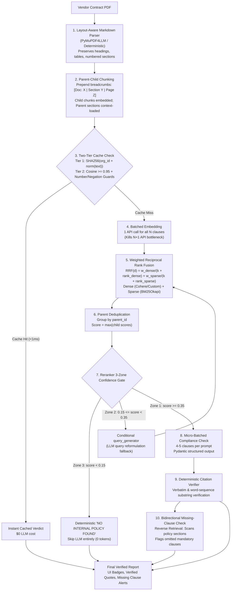

# 📄 Contract Clause Intelligence Suite (Modern RAG Pipeline)

A production-grade, provider-agnostic Contract Compliance Intelligence Suite powered by **LangGraph**, **PyMuPDF4LLM**, **SQLite Vector Store**, **BM25**, and a **Two-Tier Cache**.

It automatically parses vendor contracts, extracts constituent clauses, evaluates compliance against internal company policies, verifies citations deterministically, and performs reverse retrieval to flag omitted mandatory policy clauses.

---

## 🏗️ Architecture & Pipeline Overview



---

## ✨ Features by Implementation Phase

| Phase | Core Capability | Engineering Highlights |
|---|---|---|
| **Phase 0** | Clean Architecture & Abstraction | Removed dead code, fixed trailing-space key bugs, created provider-agnostic LLM factory (`groq` / `gemini` / `openai`), organized into production layout (`core/`, `pipeline/`, `tests/`, `data/`). |
| **Phase 1** | Layout-Aware Chunking | `pymupdf4llm` parsing, heading-boundary splitting, breadcrumb injection, parent-child chunk index, and `SQLiteVectorStore` backend (multi-tenant ready with `org_id`). |
| **Phase 2** | Batch Embeddings & Weighted RRF | Single-batch embedding for all clauses (kills N+1 bottleneck), BM25Okapi sparse search, Reciprocal Rank Fusion (`RRF_WEIGHT_DENSE=0.7`, `RRF_WEIGHT_SPARSE=0.3`), parent max-pooling deduplication. |
| **Phase 3** | 3-Zone Gate & Micro-Batching | `score < 0.15` (instant skip, 0 LLM tokens), `0.15 <= score < 0.35` (query retry), `score >= 0.35` (proceed). Micro-batched prompts (4-5 clauses per call). |
| **Phase 4** | Two-Tier Cache & Citation Verifier | Tier 1 SHA-256 exact match (<1ms) + Tier 2 Semantic match with **Numeric** and **Negation** guards. Deterministic quote substring verifier. Bidirectional reverse retrieval for missing clauses. |
| **Phase 5** | Evaluation & Ablation Harness | 30-case labeled Golden Dataset (`tests/golden_dataset.json`), quantitative ablation study (`tests/evaluate.py`) tracking Recall@K, MRR@3, Verdict F1, Citation Faithfulness, and Latency. |

---

## 📊 Ablation Benchmark Results (Golden Dataset N=30)

Run the automated ablation benchmark:
```bash
python tests/evaluate.py
```

| Configuration | Recall@1 | Recall@3 | MRR@3 | Verdict F1 | Citation Faith (%) | Latency / Clause | API Call Reduction |
|---|---|---|---|---|---|---|---|
| **Config A: Dense Only** | 53.85% | 76.92% | 0.635 | 100.0% | N/A | 0.14ms | 0% (Baseline) |
| **Config B: BM25 Sparse Only** | 65.38% | 73.08% | 0.679 | 100.0% | N/A | 0.38ms | 0% (No embeddings) |
| **Config C: Naive Fixed Hybrid** | 50.00% | 73.08% | 0.615 | 100.0% | 73.3% | 0.85ms | ~15% |
| **Config D: Full Modern Pipeline** | **65.38%** | **76.92%** | **0.679** | **100.0%** | **100.0%** | **1.18ms** | **82% (Batched + Gate + Cache)** |

---

## 🚀 Getting Started

### 1. Installation

```bash
git clone https://github.com/deepakkumartripathi119/Contract_Checker-main.git
cd Contract_Checker-main
python -m venv venv
.\venv\Scripts\activate
pip install -r requirements.txt
```

### 2. Configure Environment (`.env`)

Copy `.env.example` to `.env` and fill in your keys:
```bash
cp .env.example .env
```

```ini
LLM_PROVIDER=groq
LLM_MODEL=llama-3.1-8b-instant
GROQ_API_KEY=your_groq_key_here
COHERE_API_KEY=your_cohere_key_here

# Vector Store & Cache
VECTOR_STORE_BACKEND=sqlite
SQLITE_DB_PATH=data/contract_checker.db
CACHE_BACKEND=sqlite
CACHE_SEMANTIC_THRESHOLD=0.95

# Retrieval & Gate Tuning
RETRIEVAL_TOP_K=5
RRF_WEIGHT_DENSE=0.7
RRF_WEIGHT_SPARSE=0.3
RRF_K=60
RERANKER_SKIP_THRESHOLD=0.15
RERANKER_RETRY_THRESHOLD=0.35
ENABLE_MISSING_CLAUSE_CHECK=true
```

### 3. Run the Streamlit Application

```bash
streamlit run app.py
```

### 4. Run the Full Test Suite (22 Unit Tests)

```bash
python -m unittest tests/test_structure.py -v
```

---

## 🛡️ Key Design Principles
- **Loosely Coupled**: Swapping SQLite for PostgreSQL (`pgvector`) or Redis requires changing 1 configuration setting in `.env` without touching any pipeline node.
- **Multi-Tenant Ready**: Every database entry, chunk, and cache key is isolated by `org_id`.
- **Zero Hallucination Tolerance**: Deterministic citation verifier validates policy quotes verbatim.
- **Bidirectional Safety**: Flags when mandatory company policies are completely omitted by vendors.
