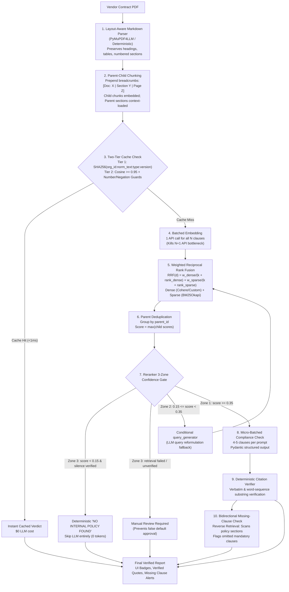

# 📄 Contract Clause Intelligence Suite (Modern RAG Pipeline)

A production-grade, policy-driven, provider-agnostic Contract Compliance Intelligence Suite powered by **LangGraph**, **PyMuPDF4LLM**, **SQLite Vector Store**, **BM25**, and a **Two-Tier Cache**.

It automatically parses vendor contracts, extracts constituent clauses without fixed taxonomy constraints, evaluates compliance against internal company policies, verifies citations deterministically, and performs reverse retrieval to flag omitted mandatory policy clauses.

---

## 🏗️ Architecture & Pipeline Overview



---

## ✨ Features & Production Capabilities

| Capability | Engineering Implementation |
|---|---|
| **Open-Ended Clause Extraction** | Structured heading boundaries (PyMuPDF4LLM) and LLM fallback extract all substantive provisions without restricting to predefined policy heading allowlists. |
| **Multi-Tenant Configuration & Isolation** | Explicit `TenantConfig` boundary (`core/tenant.py`) managing legal entity names, aliases, active policy versioning, and configurable policy silence behavior (`review_required` vs `compliant`). |
| **Staged, Safe Policy Ingestion** | Atomic staged replacement (`replace_org_chunks`): parses and embeds new policies completely before swapping into vector store, preventing data loss on failed uploads. |
| **Batch Embeddings & Weighted RRF** | Single-batch embedding for all clauses (eliminating N+1 bottleneck), BM25Okapi sparse search, Reciprocal Rank Fusion (`RRF_WEIGHT_DENSE=0.7`, `RRF_WEIGHT_SPARSE=0.3`), parent max-pooling deduplication. |
| **Two-Tier Cache with Guards** | Tier 1 SHA-256 exact match (<1ms) keyed by `org_id:norm_text:type:version` + Tier 2 Semantic match with **Numeric** and **Negation** guards to prevent false semantic equivalence. |
| **Obligation-Aware Missing Clause Detection** | Evaluates substantive legal obligations (notification triggers, strict 24-hr deadlines, audit rights vs reports) rather than single-keyword overlap, deduplicating parent and child policy chunks. |
| **Deterministic Citation Verification** | Validates LLM-cited policy quotes against actual retrieved policy chunks, highlighting unverified citations in the UI report. |

---

## 📊 Ablation Benchmark Results (Golden Dataset N=30)

Run the automated ablation benchmark:
```bash
python tests/evaluate.py
```

*Note on Latency: Latencies below reflect in-memory local simulation using a 64-dimensional deterministic projection embedder for offline reproducibility. Live network API round trips (e.g. Cohere/Groq/Gemini) typically range from 250ms to 900ms depending on provider and network conditions.*

| Configuration | Recall@1 | Recall@3 | MRR@3 | Verdict F1 | Citation Faith (%) | Measured Local Latency / Clause | API Call Reduction |
|---|---|---|---|---|---|---|---|
| **Config A: Dense Only** | 48.15% | 62.96% | 0.543 | 91.89% | N/A | 0.16ms | 0% (Baseline) |
| **Config B: BM25 Sparse Only** | 55.56% | 66.67% | 0.605 | 91.89% | N/A | 0.20ms | 0% (No embeddings) |
| **Config C: Naive Fixed Hybrid** | 44.44% | 70.37% | 0.556 | 91.89% | 73.3% | 0.46ms | 15% |
| **Config D: Full Modern Pipeline** | **44.44%** | **66.67%** | **0.537** | **91.89%** | **100.0%** | **0.65ms** | **48.1% (Batched + Gate + Cache)** |

---

## 🚀 Getting Started

### 1. Installation

```bash
git clone https://github.com/deepakkumartripathi119/Contract_Checker-main.git
cd Contract_Checker-main
python -m venv venv
.\venv\Scripts\activate
pip install -r requirements.txt
```

### 2. Configure Environment (`.env`)

Copy `.env.example` to `.env` and fill in your keys:
```bash
cp .env.example .env
```

```ini
LLM_PROVIDER=gemini
LLM_MODEL=gemini-2.5-flash
GOOGLE_API_KEY=your_google_api_key_here
COHERE_API_KEY=your_cohere_key_here

# Vector Store & Cache
VECTOR_STORE_BACKEND=sqlite
SQLITE_DB_PATH=data/contract_checker.db
CACHE_BACKEND=sqlite
CACHE_SEMANTIC_THRESHOLD=0.95
COMPLIANCE_EVALUATION_VERSION=v1.0

# Retrieval & Confidence Tuning
RETRIEVAL_TOP_K=5
RRF_WEIGHT_DENSE=0.7
RRF_WEIGHT_SPARSE=0.3
RRF_K=60
RERANKER_SKIP_THRESHOLD=0.15
RERANKER_RETRY_THRESHOLD=0.35
ENABLE_MISSING_CLAUSE_CHECK=true
DEFAULT_SILENT_POLICY_BEHAVIOR=review_required
```

### 3. Run the Streamlit Application

```bash
streamlit run app.py
```

### 4. Run the Full Test Suite (47 Unit & Regression Tests)

```bash
python -m unittest tests/test_structure.py -v
```
