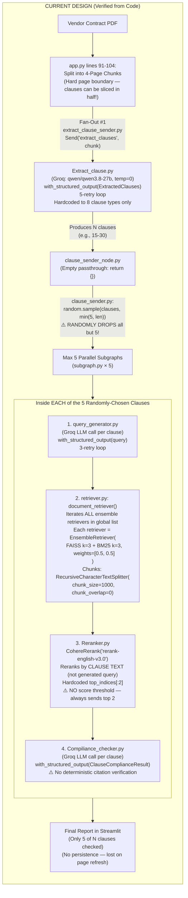
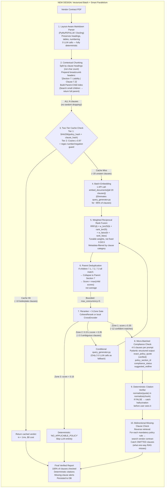

# Contract Checker: Actual Current Design vs. Proposed New Design

> **Why these differ from the previous conversation's diagrams:** The previous agent couldn't read your code (compressed .zip). Now that I've read every file, here are the corrections.

---

## Current Design (What Your Code ACTUALLY Does Today)

> [!WARNING]
> Key corrections from the previous conversation:
> - LLM is **Groq (`qwen/qwen3.8-27b`)**, not Gemini
> - Only **5 randomly-sampled clauses** are checked, not 30
> - Embeddings are **Cohere (`embed-english-v3.0`)**, not Google
> - `RAG.py` is dead code — active retrieval is in `retriever.py`
> - `COHERE_API_KEY` has a **trailing space bug** in `retriever.py` line 21

### Actual API calls per contract (5 clauses checked):

| Stage | API Calls | Provider |
|---|---|---|
| Clause Extraction | 1-3 Groq calls (per 4-page chunk) | Groq |
| Query Generation | 5 Groq calls (1 per clause) | Groq |
| Embedding (inside FAISS retriever) | 5 Cohere calls (1 per query) | Cohere |
| Reranking | 5 Cohere calls (1 per clause) | Cohere |
| Compliance Check | 5 Groq calls (1 per clause) | Groq |
| **Total** | **~21-23 API calls** | Mixed |

---

## Proposed New Design (The 6 Agreed Upgrades)

### Projected API calls per contract (ALL 30 clauses checked):

| Stage | Old (5 random clauses) | New (ALL 30 clauses) | Reduction |
|---|---|---|---|
| Clause Extraction | 1-3 LLM calls | **0** (deterministic parser) | **100%** |
| Query Generation | 5 LLM calls | **2-3** (fallback only) | **50-60%** |
| Embedding | 5 HTTP calls | **1** (batched) | **80%** |
| Reranking | 5 Cohere calls | **~4** (bounded, some skipped) | **20%** |
| Compliance Check | 5 LLM calls | **3-4** (micro-batched, cached skip) | **30%** |
| **Total** | **~21-23** (only 5 clauses!) | **~10-12** (ALL 30 clauses!) | **~50% fewer calls, 6× more clauses checked** |

---

## Side-by-Side: What Each Upgrade Fixes

| Problem in Current Code | File & Line | Upgrade That Fixes It |
|---|---|---|
| Hard 4-page split slices clauses in half | [app.py L91-93](file:///c:/Users/deepa/OneDrive/Desktop/projects/Contract_Checker-main/Contract_Checker-main/app.py#L91-L93) | #1: Layout-aware Markdown parsing |
| `chunk_size=1000, chunk_overlap=0` loses headings | [retriever.py L47](file:///c:/Users/deepa/OneDrive/Desktop/projects/Contract_Checker-main/Contract_Checker-main/retriever.py#L47) | #2: Contextual breadcrumb headers + parent-child |
| `random.sample(clauses, min(5, len))` drops clauses | [clause_sender.py L9-10](file:///c:/Users/deepa/OneDrive/Desktop/projects/Contract_Checker-main/Contract_Checker-main/clause_sender.py#L9-L10) | Remove random sampling; check ALL clauses |
| 1 LLM call per clause in `query_generator.py` | [query_generator.py L29](file:///c:/Users/deepa/OneDrive/Desktop/projects/Contract_Checker-main/Contract_Checker-main/query_generator.py#L29) | #4: Batch embedding; query gen as fallback only |
| `weights=[0.5, 0.5]` fixed ensemble (no tuning) | [retriever.py L65](file:///c:/Users/deepa/OneDrive/Desktop/projects/Contract_Checker-main/Contract_Checker-main/retriever.py#L65) | #5: Explicit Weighted RRF with tunable weights |
| `reranked_docs[:2]` with no score threshold | [Reranker.py L53](file:///c:/Users/deepa/OneDrive/Desktop/projects/Contract_Checker-main/Contract_Checker-main/Reranker.py#L53) | #7: 3-Zone confidence gate |
| No citation verification in compliance output | [Compiliance_checker.py L79-89](file:///c:/Users/deepa/OneDrive/Desktop/projects/Contract_Checker-main/Contract_Checker-main/Compiliance_checker.py#L79-L89) | #9: Deterministic substring verifier |
| One-way check (misses omitted mandatory clauses) | Structural gap | #10: Bidirectional reverse retrieval |
| `COHERE_API_KEY ` trailing space bug | [retriever.py L21](file:///c:/Users/deepa/OneDrive/Desktop/projects/Contract_Checker-main/Contract_Checker-main/retriever.py#L21) | Fix env var key string |
| Dead code: `RAG.py`, `Retrivers.py` | Not imported anywhere | Delete both files |

> [!IMPORTANT]
> **Key difference from previous conversation:** The current design actually processes **~21 API calls for 5 random clauses**, not "125+ for 30 clauses" as the previous agent claimed. The new design processes **~10-12 API calls for ALL 30 clauses** — meaning we check **6× more clauses with fewer API calls**.
